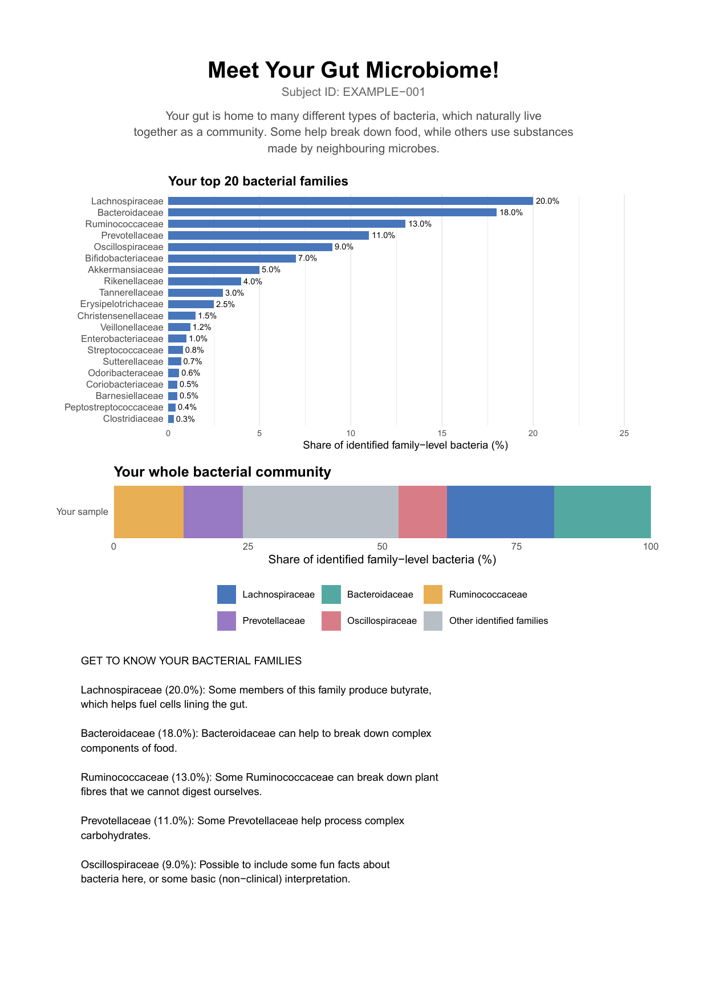
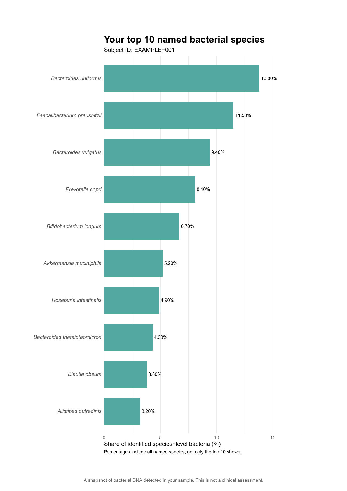

# Gut (Or Any Other) Microbiome Individual Participant Reports
R-based workflow for generating individualised participant-level PDF reports summarising microbiome composition. The gut microbiome is used as an example here.

## Overview
This repository contains a workflow to turn microbiome sequencing data into accessible, individual participant reports. This may be necessary when providing participants a summary of their gut microbiome after study participation. The workflow integrates bacterial abundance data, taxonomic classifications, and sample metadata to generate individual PDF summaries of gut microbial community composition.

## Example Report
The images below show an example of the participant-level
gut microbiome report generated using synthetic data.

### Page 1 – Bacterial Family Composition

### Page 2 – Bacterial Species Composition

*Note: This example uses entirely synthetic data for
demonstration purposes. No real participant data are shown.*

## Report Contents
Each participant report contains two pages:
### Page 1 - Bacterial Family Composition

- Relative abundance of the 20 most abundant bacterial families.
- Visual summary of the five most abundant families and the remaining identified families.
- Brief, accessible descriptions of selected bacterial families and their potential roles in the gut microbiome.

### Page 2 - Bacterial Species Composition
- Relative abundance of the 10 most abundant named bacterial species.
- Individual sample identification.
- Explanatory information to support interpretation.

## Analytical Workflow
1. Import microbiome abundance, taxonomy, and metadata tables.
2. Construct a phyloseq object.
3. Select baseline (Visit 1) samples.
4. Process bacterial taxonomic classifications and calculate relative abundances.
5. Generate family- and species-level visualisations using ggplot2.
6. Export individual participant reports as PDF documents.

## Software and Dependencies
The workflow is implemented in R version 4.6.1 using:
- readxl
- dplyr
- tibble
- phyloseq
- ggplot2
- grid

## Data Availability
Participant-level research data are not publicly available in this repository. The illustrations shown here were produced from fabricated data. 

## Interpretation
Reports provide descriptive summaries of gut microbiome composition for interest purposes and are not intended as clinical or diagnostic assessments.
